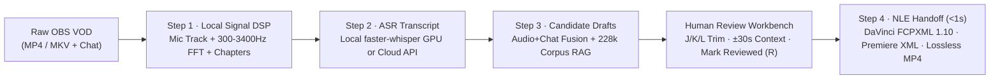

<div align="center">

English · [简体中文](./docs/readme/README.zh-CN.md) · [繁體中文](./docs/readme/README.zh-TW.md) · [日本語](./docs/readme/README.ja.md) · [한국어](./docs/readme/README.ko.md) · [Русский](./docs/readme/README.ru.md) · [Español](./docs/readme/README.es.md)

<h1>Solacut: Local VOD Assistant Editor</h1>

<h3>One local darkroom workbench for long-form VOD rough-cuts, 6-language subtitle localization, and NLE timeline handoff.</h3>

<p>Drop a 4-hour raw recording. Spot real hype moments, fix gaming slang, and send clean timelines straight into Premiere Pro &amp; DaVinci Resolve — 100% on your machine.</p>

[](https://github.com/Entelina/solacut/releases)
[](./LICENSE)
[-3b82f6)](https://solacut.com)
[](#6-language-localization--corpus)
[](./THIRD_PARTY_NOTICES.md)
[](./SECURITY.md)

[**Website**](https://solacut.com) · [**Download Portable (.zip)**](https://github.com/Entelina/solacut/releases/latest) · [**User Manual**](./USER_MANUAL.md) · [**Security**](./SECURITY.md)

[Quick Start](#quick-start) · [Why Solacut](#why-solacut-utility-not-ai-slop) · [How Solacut Works](#how-solacut-works) · [6-Language Studio](#6-language-localization--corpus) · [CLI Pipeline](#modular-cli-pipeline) · [FAQ](#faq)

`Solacut.exe  # or inside app: Help → Load 30s Demo Project (zero API key needed)`

<br/>


</div>

---

## Why Solacut: Utility, Not AI Slop

Creators hate black-box "AI clippers" that upload multi-gigabyte VODs to the cloud, charge per minute, butcher comedic timing, hallucinate literal translations, and spit out generic template videos.

**Solacut is built as an Assistant Editor — never a creative replacement.** Every frame stays on your local drive, and every export decision stays in human hands:

- **100% Local Media & Zero Cloud Upload**: Raw MP4/MKV/MOV recordings never leave your disk. Audio DSP, OBS chapter extraction, chat heatmap indexing, and corpus retrieval run locally in milliseconds.
- **Tri-Signal Highlight Radar (Voice + OBS Chapters + Chat Velocity)**:
  - Automatically inspects multi-track OBS recordings, recommends your isolated **Clean Streamer Mic** track, and applies a pure NumPy `300–3400 Hz` vocal bandpass FFT filter so gunshots and engine roar don't trigger false peaks.
  - Detects `>= 15s` **Dead-Air / AFK** stretches for optional `Skip Air` review playback — without ever mangling natural speech pauses.
  - Reads embedded **OBS Chapter Markers** natively and imports **TwitchDownloader JSON / Bilibili XML / YouTube Live Chat** logs into a local SQLite FTS5 heatmap (`OMEGALUL`, `CLIP IT`, `草`, `ㅋㅋ`, `www`) to catch silent clutches and deadpan sarcasm.
- **Full Transcript Text-Editing & `±30s Source Context`**:
  - Search any word across the entire VOD transcript, select lines, and build clips manually — zero LLM required.
  - Open **`±30s Source Context`** on any candidate clip to verify surrounding banter before approving translations.
- **Human-in-the-Loop `Draft → Reviewed` Gate**:
  - AI candidates start as `Draft` with automatic high-slang / fallback alerts. Press `R` after verification to mark `✓ Reviewed`. The **Deliver** tab defaults to **`Only Reviewed`** so unverified rough drafts never slip into production.
- **NLE-First Handoff (`< 1s` Zero Re-encode)**:
  - Default **`NLE XML`** delivery generates spec-compliant **DaVinci Resolve / Final Cut Pro `FCPXML 1.10`** (dual-sequence: full annotated VOD + assembled selects) and **Premiere Pro `FCP7 XML (xmeml v5)`** with stereo tracks, masterclip links, and OBS markers intact — plus CMX 3600 EDL, DaVinci CSV, aligned `.srt`, or keyframe-compensated FFmpeg lossless cuts.

---

## Quick Start

### Option 1: Windows 64-bit Portable Edition (Recommended)

1. Download the latest `Solacut-v*-win64-portable.zip` from [**solacut.com**](https://solacut.com) or [**GitHub Releases**](https://github.com/Entelina/solacut/releases/latest).
2. Extract anywhere and double-click **`Solacut.exe`** (bundled with static `ffmpeg`/`ffprobe`, Edge WebView2 darkroom shell, and 228,210 commercial-safe bilingual corpus entries — no Python install needed).
3. **Try instantly without an API key**: Click **`Load 30s Demo Project`** in the welcome prompt (or `Help → Load 30s Demo Project`) to explore real dual-track gameplay, OBS chapters, Twitch chat spikes, bilingual CC modes, and `< 1s` XML export offline.

### Option 2: Run from Source (Windows PowerShell · Python 3.11)

> Python 3.11 is pinned in `.venv` for prebuilt `faster-whisper` / `ctranslate2` CUDA compatibility.

```powershell
# Launch native frameless desktop workbench (recommended)
.\.venv\Scripts\pythonw.exe src/desktop_app.py

# Or launch in browser debug mode
.\.venv\Scripts\python.exe src/desktop_app.py --browser
```

---

## How Solacut Works



| Stage | What Runs | Cost & Privacy |
| :--- | :--- | :--- |
| **1. Signal & Chat Radar** | Multi-track mic probe, `300–3400 Hz` vocal FFT, `>=15s` dead-air detection, OBS chapters, local SQLite chat spike indexing | **Free · 100% Offline** |
| **2. Speech-to-Text (ASR)** | Local RTX GPU `faster-whisper (large-v3-turbo)` with Silero VAD, or OpenAI-compatible cloud ASR | **Free on Local GPU** (or BYOK API) |
| **3. Rough Screening & 6×6 Drafts** | Retrieves gaming idioms & glossary hits from local SQLite FTS5 corpus, generates `Draft` clips & bilingual subtitles | **BYOK API or Local Ollama/vLLM** |
| **4. Darkroom Review & NLE Export** | `J/K/L` 8x shuttle, `I/O` trim, 5 CC preview modes, `Draft → Reviewed` gate, `< 1s` FCPXML / Premiere XML / Lossless cut | **Free · 100% Offline** |

---

## 6-Language Localization & Corpus

Both the **Workbench UI** (default `English`) and the **6×6 Subtitle Studio** support instant switching across six languages:

- **Supported Languages**: `English (en)` · `简体中文 (zh)` · `日本語 (ja)` · `한국어 (ko)` · `Русский (ru)` · `Español (es)`
- **5 Real-Time CC Monitor Modes**: Bilingual (Target Top) · Bilingual (Source Top) · Target Only · Source Only · Subtitles Off — plus 1-click target language retranslation and CJK-safe ASS font matching.
- **2-Tier License-Clean Local Corpus**:
  - **Bundled Commercial-Safe Pack (`228,210` pairs)**: Strictly built with `--commercial-only` (`MIT / CC BY 2.0 / CC BY-SA 4.0` + Solacut original gaming slang & anti-literal glossary). Zero NC/ND restrictions.
  - **Optional Personal Research Pack (`600,000` pairs)**: One-click on-demand local index expansion from official OPUS mirrors inside the `Glossary` tab (see [`THIRD_PARTY_NOTICES.md`](./THIRD_PARTY_NOTICES.md)).

```powershell
# Build commercial-safe 228k corpus index (default for portable releases)
.\.venv\Scripts\python.exe src/corpus_builder.py --lang-pair all --commercial-only

# Expand to full 600k personal research spoken corpus locally
.\.venv\Scripts\python.exe src/corpus_builder.py --lang-pair all
```

---

## Modular CLI Pipeline

Every stage can also be scripted standalone from PowerShell:

```powershell
# Step 1: List OBS audio tracks & run vocal bandpass analysis on clean mic stream #1
.\.venv\Scripts\python.exe src/step1_audio.py input/obs_vod.mkv --list-streams
.\.venv\Scripts\python.exe src/step1_audio.py input/obs_vod.mkv --audio-stream 1

# Step 2: Transcribe via local GPU faster-whisper (or omit flags for configured API)
.\.venv\Scripts\python.exe src/step2_asr.py output/obs_vod_audio_peaks.json --asr-provider local --asr-model large-v3-turbo

# Step 3: Screen candidates & generate 6x6 bilingual draft subtitles
.\.venv\Scripts\python.exe src/step3_llm.py output/obs_vod_transcript.json

# Step 4A: <1s zero-transcode export for DaVinci Resolve (FCPXML 1.10) & Premiere Pro (XML)
.\.venv\Scripts\python.exe src/step4_cut.py output/obs_vod_highlights.json --mode nle_only --only-reviewed

# Step 4B: Keyframe-compensated lossless MP4 cuts (+ XML/EDL/CSV/SRT)
.\.venv\Scripts\python.exe src/step4_cut.py output/obs_vod_highlights.json --mode lossless --only-reviewed
```

---

## FAQ

<details>
<summary><b>Does Solacut upload my videos or API keys anywhere?</b></summary>
<br/>
Never. Solacut has zero telemetry, zero cloud accounts, and zero media upload servers. Your videos stay on your local disk. If you configure an optional cloud LLM/ASR key, requests go directly from your machine to your chosen endpoint (or `localhost` via Ollama / vLLM), and keys are redacted from logs and excluded from portable builds. See <a href="./SECURITY.md"><code>SECURITY.md</code></a>.
</details>

<details>
<summary><b>Can I use Solacut completely free without any API key?</b></summary>
<br/>
Yes. Multi-track waveform inspection, <code>&gt;=15s</code> dead-air skipping, OBS chapter conversion, Twitch/Bilibili/YouTube chat spike heatmaps, local GPU <code>faster-whisper</code> transcription, full-transcript search clipping, and DaVinci / Premiere XML timeline exports all work 100% offline with zero API keys.
</details>

<details>
<summary><b>What is inside the built-in 30s Demo Project?</b></summary>
<br/>
<code>assets/demo/demo_highlight_30s.mp4</code> is a license-clean open-source gameplay recording (<i>SuperTuxKart 2.x</i>, CC BY 3.0) muxed with dual OBS-style audio tracks (<code>Track 0: Desktop Program Mix</code> + <code>Track 1: Streamer Mic Clean</code>), 3 embedded OBS chapter markers, aligned bilingual subtitles, and a 50-message multi-language chat log with 2 hype spikes.
</details>

---

## Testing & Verification

```powershell
# Run full automated unit & security test suite
.\.venv\Scripts\python.exe -m unittest discover -s tests -v

# Verify portable release SHA-256 checksum on Windows PowerShell
Get-FileHash .\Solacut-v0.9.3-beta-win64-portable.zip -Algorithm SHA256
```

## License

Released under the [MIT License](./LICENSE). Third-party open-source components, bundled FFmpeg notices, and open corpus attributions are documented in [`THIRD_PARTY_NOTICES.md`](./THIRD_PARTY_NOTICES.md).
