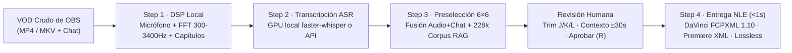

<div align="center">

[English](../../README.md) · [简体中文](./README.zh-CN.md) · [繁體中文](./README.zh-TW.md) · [日本語](./README.ja.md) · [한국어](./README.ko.md) · [Русский](./README.ru.md) · **Español**

<h1>Solacut: Editor Asistente Local de VODs y Estudio de Subtítulos en 6 Idiomas</h1>

<h3>Estación de trabajo NLE 100% local para preselección de directos largos, localización natural de subtítulos en 6 idiomas y entrega instantánea de líneas de tiempo.</h3>

<p>Arrastra una grabación cruda de 4 horas. Detecta momentos épicos reales, corrige traducciones literales de jerga gamer y envía líneas de tiempo limpias a Premiere Pro y DaVinci Resolve en menos de 1 segundo — 100% en tu PC, sin subir nada a la nube.</p>

[](https://github.com/Entelina/solacut/releases)
[](../../LICENSE)
[-3b82f6)](https://solacut.com)
[](#localización-en-6-idiomas-y-corpus-local)
[](../../THIRD_PARTY_NOTICES.md)
[](../../SECURITY.md)

[**Sitio Oficial**](https://solacut.com) · [**Descargar Portable (.zip)**](https://github.com/Entelina/solacut/releases/latest) · [**Manual de Usuario**](../../USER_MANUAL.md) · [**Seguridad**](../../SECURITY.md)

[Inicio Rápido](#inicio-rápido) · [Filosofía](#por-qué-solacut-utilidad-profesional-no-basura-automática-de-ia) · [Cómo Funciona](#cómo-funciona) · [Estudio de 6 Idiomas](#localización-en-6-idiomas-y-corpus-local) · [CLI Modular](#pipeline-cli-modular) · [FAQ](#preguntas-frecuentes-faq)

`Solacut.exe  # Sin clave API: abre Help → Load 30s Demo Project para probar la demo real offline`

<br/>


</div>

---

## Por qué Solacut: Utilidad Profesional, No Basura Automática de IA

Los creadores y editores están cansados de los «recortadores de IA» de caja negra que obligan a subir decenas de gigabytes a la nube, cobran por minuto, arruinan el ritmo cómico y destrozan el sarcasmo y la jerga gamer con traducciones literales robóticas.

**Solacut está diseñado bajo la filosofía Human-in-the-Loop: un Editor Asistente local que hace el trabajo pesado sin quitarle el control creativo al editor humano**:

- **100% Local · Cero Subidas a la Nube**: Tus grabaciones MP4 / MKV / MOV jamás salen de tu disco duro. El análisis DSP de audio, los capítulos de OBS, el mapa de calor del chat y el corpus local se ejecutan en milisegundos sin internet.
- **Radar Triple de Momentos Clave (Voz + Capítulos OBS + Velocidad del Chat)**:
  - Analiza grabaciones multipista de OBS, recomienda automáticamente la pista limpia del micrófono del streamer y aplica un filtro FFT paso banda vocal (`300–3400 Hz` en NumPy) para evitar falsos positivos por disparos o motores.
  - Detecta silencios / AFK de `>= 15s` para saltarlos opcionalmente con `Skip Air` durante la revisión sin cortar pausas naturales al hablar.
  - Extrae de forma nativa **marcadores de capítulos de OBS** e importa chats de **TwitchDownloader JSON / Bilibili XML / YouTube Live Chat** en SQLite FTS5 (`qué locura`, `jajaja`, `no manches`, `OMEGALUL`, `CLIP IT`) para capturar jugadas silenciosas e ironías.
- **Edición por Transcripción Completa y `±30s Source Context`**:
  - Busca cualquier palabra en la pestaña `Transcript` y crea clips manualmente sin depender de IA.
  - Abre **`±30s Source Context`** con un clic para verificar los 30 segundos previos y posteriores antes de dar por buena una traducción.
- **Control de Calidad `Draft → Reviewed` y Entrega NLE en `< 1s`**:
  - Los borradores inician como `Draft`; tras revisarlos, pulsa `R` para marcarlos como `✓ Reviewed` (`Only Reviewed` viene activado por defecto al exportar).
  - Exportación instantánea (`< 1s` sin recodificar) a **DaVinci Resolve / Final Cut Pro `FCPXML 1.10`** (doble secuencia) y **Premiere Pro `FCP7 XML (xmeml v5)`**, además de cortes sin pérdida con FFmpeg.

---

## Inicio Rápido

### Opción 1: Edición Portable para Windows 64-bit (Recomendada · Sin instalar Python)

1. Descarga el último `Solacut-v*-win64-portable.zip` desde [**solacut.com**](https://solacut.com) o [**GitHub Releases**](https://github.com/Entelina/solacut/releases/latest).
2. Descomprímelo en cualquier carpeta y haz doble clic en **`Solacut.exe`** (incluye `ffmpeg`/`ffprobe` estáticos, interfaz sin bordes Edge WebView2 y 228.210 pares de corpus aptos para uso comercial).
3. **Pruébalo al instante sin API key**: Haz clic en **`Load 30s Demo Project`** en la ventana inicial (o en `Help → Load 30s Demo Project`) para explorar gameplay real de código abierto con doble pista de audio, capítulos OBS y picos de chat offline.

### Opción 2: Ejecutar desde el Código Fuente (Windows PowerShell · Python 3.11)

```powershell
# Iniciar estación de escritorio nativa sin bordes (recomendado)
.\.venv\Scripts\pythonw.exe src/desktop_app.py

# O iniciar en modo depuración de navegador
.\.venv\Scripts\python.exe src/desktop_app.py --browser
```

---

## Cómo Funciona



---

## Localización en 6 Idiomas y Corpus Local

- **Idiomas soportados (interfaz y subtítulos 6×6)**: `English (en)` · `简体中文 (zh)` · `日本語 (ja)` · `한국어 (ko)` · `Русский (ru)` · `Español (es)`
- **5 modos de vista previa CC en tiempo real**: Bilingüe (traducción arriba / origen arriba) · Solo traducción · Solo origen · Desactivado.
- **Corpus local en 2 niveles con licencias limpias**: La edición portable incluye **228.210 pares** sin restricciones comerciales (`MIT / CC BY 2.0 / CC BY-SA 4.0` + glosario original de jerga gamer). Para estudio personal puede ampliarse localmente a **600.000 pares** desde la pestaña `Glossary` (consulta [`THIRD_PARTY_NOTICES.md`](../../THIRD_PARTY_NOTICES.md)).

---

## Pipeline CLI Modular

```powershell
.\.venv\Scripts\python.exe src/step1_audio.py input/obs_vod.mkv --audio-stream 1
.\.venv\Scripts\python.exe src/step2_asr.py output/obs_vod_audio_peaks.json --asr-provider local --asr-model large-v3-turbo
.\.venv\Scripts\python.exe src/step3_llm.py output/obs_vod_transcript.json
.\.venv\Scripts\python.exe src/step4_cut.py output/obs_vod_highlights.json --mode nle_only --only-reviewed
```

---

## Preguntas Frecuentes (FAQ)

<details>
<summary><b>¿Solacut sube mis vídeos o claves API a algún servidor externo?</b></summary>
<br/>
Jamás. Solacut no tiene telemetría, cuentas en la nube ni servidores intermedios. Tus vídeos permanecen siempre en tu disco local. Más detalles en <a href="../../SECURITY.md"><code>SECURITY.md</code></a>.
</details>

---

## Licencia

Publicado bajo la licencia [MIT License](../../LICENSE). Las atribuciones de componentes de código abierto, FFmpeg y corpus se detallan en [`THIRD_PARTY_NOTICES.md`](../../THIRD_PARTY_NOTICES.md).
