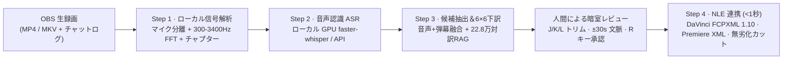

<div align="center">

[English](../../README.md) · [简体中文](./README.zh-CN.md) · [繁體中文](./README.zh-TW.md) · **日本語** · [한국어](./README.ko.md) · [Русский](./README.ru.md) · [Español](./README.es.md)

<h1>Solacut: ローカル完結型 VOD アシスタント編集＆6言語字幕ワークベンチ</h1>

<h3>長時間の配信アーカイブ粗編集・6言語ネイティブ字幕ローカライズ・NLE タイムライン連携のための完全ローカル暗室ワークベンチ。</h3>

<p>数時間の生録画をそのままドロップ。盛り上がり箇所の特定、ゲームスラングの誤訳補正、Premiere Pro / DaVinci Resolve へのタイムライン書き出しを 1 秒未満で——すべてあなたの PC 内で完結します。</p>

[](https://github.com/Entelina/solacut/releases)
[](../../LICENSE)
[-3b82f6)](https://solacut.com)
[](#6言語ローカライズとローカルコーパス)
[](../../THIRD_PARTY_NOTICES.md)
[](../../SECURITY.md)

[**公式サイト**](https://solacut.com) · [**ポータブル版ダウンロード (.zip)**](https://github.com/Entelina/solacut/releases/latest) · [**ユーザーマニュアル**](../../USER_MANUAL.md) · [**セキュリティ仕様**](../../SECURITY.md)

[クイックスタート](#クイックスタート) · [設計思想](#なぜ-solacut-なのかai量産ゴミではなく編集者の右腕として) · [仕組み](#仕組み) · [6言語スタジオ](#6言語ローカライズとローカルコーパス) · [CLI パイプライン](#モジュラー-cli-パイプライン) · [FAQ](#よくある質問-faq)

`Solacut.exe  # APIキー不要：アプリ内の Help → Load 30s Demo Project で実機デモを即体験`

<br/>


</div>

---

## なぜ Solacut なのか：AI量産ゴミではなく、編集者の右腕として

何十GBもの配信録画をクラウドへアップロードさせ、分単位で課金し、絶妙な間（ま）をぶつ切りにして不自然な直訳字幕を焼き付ける「ブラックボックス型 AI 切り抜きツール」に、多くのクリエイターや切り抜き職人がうんざりしています。

**Solacut は人間が主導権を握る（Human-in-the-Loop）「アシスタントエディター」として設計されています**：

- **100% ローカル処理・クラウド送信ゼロ**：生の MP4 / MKV / MOV 録画は一切外部へ送信されません。音声 DSP、OBS チャプター抽出、コメント熱量解析、コーパス検索はすべてローカルでミリ秒単位で動作します。
- **音声 × OBS チャプター × コメント熱量の 3 軸ハイライトレーダー**：
  - OBS マルチトラック録画から配信者の**クリーンなマイクトラック**を自動推奨し、NumPy `300–3400 Hz` 声帯バンドパス FFT により銃声やエンジン音の誤検知を排除。
  - `15秒以上` の離席・無音区間（Dead Air）を検出し、自然な会話の間を壊さずに試聴時のみ `Skip Air` でスキップ可能。
  - 動画内の **OBS チャプターマーカー**をネイティブ抽出し、さらに **TwitchDownloader JSON / ニコニコ・Bilibili XML / YouTube Live Chat** をローカル SQLite FTS5 で解析（`草`・`www`・`神プレイ`・`OMEGALUL`・`CLIP IT` などの弾幕ピークを可視化）。無言の神プレイやクールな皮肉も見逃しません。
- **全文文字起こし検索クリップ作成 ＆ `±30s Source Context` 前後文脈確認**：
  - AI を使わなくても、`Transcript` タブでキーワード検索して台詞を選択するだけで手動クリップ作成が可能。
  - 翻訳チェック時はワンクリックで **`±30s Source Context`（前後30秒の原文脈）**を開き、皮肉や文脈の取り違えを防止します。
- **`Draft → Reviewed` 品質ゲートと `< 1秒` NLE タイムライン連携**：
  - AI 候補はまず `Draft`（下書き）として生成され、人間が確認して `R` キーを押した `✓ Reviewed` クリップのみをデフォルトで書き出し。
  - **DaVinci Resolve / Final Cut Pro `FCPXML 1.10`**（2シーケンス構成）および **Premiere Pro `FCP7 XML (xmeml v5)`** を再エンコードなし・1秒未満で生成します。

---

## クイックスタート

### 方法 1：Windows 64-bit ポータブル版（推奨・Python インストール不要）

1. [**solacut.com**](https://solacut.com) または [**GitHub Releases**](https://github.com/Entelina/solacut/releases/latest) から最新の `Solacut-v*-win64-portable.zip` をダウンロードします。
2. 任意のフォルダに展開し、**`Solacut.exe`** をダブルクリックして起動します（静的 `ffmpeg`/`ffprobe`・Edge WebView2 シェル・商用利用可能な 228,210 件の対訳コーパスを同梱）。
3. **API キーなしで即体験**：初回ダイアログまたは上部メニュー **`Help → Load 30s Demo Project`** をクリックすると、オープンソース実機ゲーム映像・2トラック音声・OBSチャプター・コメント熱量データ入りの30秒デモプロジェクトをオフラインで試せます。

### 方法 2：ソースコードから起動（Windows PowerShell · Python 3.11）

```powershell
# フレームレス ネイティブデスクトップ版を起動（推奨）
.\.venv\Scripts\pythonw.exe src/desktop_app.py

# ブラウザデバッグモードで起動
.\.venv\Scripts\python.exe src/desktop_app.py --browser
```

---

## 仕組み



---

## 6言語ローカライズとローカルコーパス

- **対応6言語（UI・字幕とも即時切替）**：`English (en)` · `简体中文 (zh)` · `日本語 (ja)` · `한국어 (ko)` · `Русский (ru)` · `Español (es)`
- **5種類のリアルタイム CC オーバーレイ**：二言語（訳文上）・二言語（原文上）・訳文のみ・原文のみ・非表示。
- **ライセンス明確な2段階コーパス**：ポータブル版には商用利用制限のない **228,210 件**（`MIT / CC BY 2.0 / CC BY-SA 4.0`＋独自ゲーム用語辞書）のみを同梱。個人研究用には `Glossary` タブからワンクリックで **600,000 件**までローカル拡張可能です（詳細は [`THIRD_PARTY_NOTICES.md`](../../THIRD_PARTY_NOTICES.md)）。

---

## モジュラー CLI パイプライン

```powershell
.\.venv\Scripts\python.exe src/step1_audio.py input/obs_vod.mkv --audio-stream 1
.\.venv\Scripts\python.exe src/step2_asr.py output/obs_vod_audio_peaks.json --asr-provider local --asr-model large-v3-turbo
.\.venv\Scripts\python.exe src/step3_llm.py output/obs_vod_transcript.json
.\.venv\Scripts\python.exe src/step4_cut.py output/obs_vod_highlights.json --mode nle_only --only-reviewed
```

---

## よくある質問 (FAQ)

<details>
<summary><b>動画ファイルや API キーが外部サーバーへアップロードされることはありますか？</b></summary>
<br/>
一切ありません。テレメトリ送信もクラウドアカウントも存在せず、録画データは常にローカルディスク上に留まります。詳細は <a href="../../SECURITY.md"><code>SECURITY.md</code></a> をご覧ください。
</details>

---

## ライセンス

[MIT License](../../LICENSE) の下で公開されています。同梱 OSS・FFmpeg ライセンス・オープンコーパスの帰属表示は [`THIRD_PARTY_NOTICES.md`](../../THIRD_PARTY_NOTICES.md) に記載しています。
