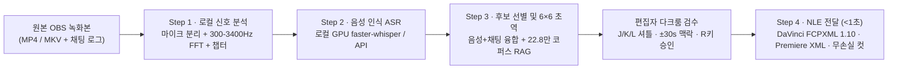

<div align="center">

[English](../../README.md) · [简体中文](./README.zh-CN.md) · [繁體中文](./README.zh-TW.md) · [日本語](./README.ja.md) · **한국어** · [Русский](./README.ru.md) · [Español](./README.es.md)

<h1>Solacut: 로컬 완결형 VOD 어시스턴트 편집 및 6개 국어 자막 워크벤치</h1>

<h3>장시간 방송 다시보기 가편집, 6개 국어 원어민급 자막 현지화, 그리고 전문 NLE 타임라인 연동을 위한 100% 로컬 다크룸 워크벤치.</h3>

<p>4시간짜리 원본 녹화본을 그대로 넣으세요. 진짜 하이라이트 포착, 게임 밈·은어 오역 교정, Premiere Pro 및 DaVinci Resolve 타임라인 내보내기까지 1초 만에 내 PC에서 끝납니다.</p>

[](https://github.com/Entelina/solacut/releases)
[](../../LICENSE)
[-3b82f6)](https://solacut.com)
[](#6개-국어-현지화-및-로컬-코퍼스)
[](../../THIRD_PARTY_NOTICES.md)
[](../../SECURITY.md)

[**공식 웹사이트**](https://solacut.com) · [**무설치 포터블 다운로드 (.zip)**](https://github.com/Entelina/solacut/releases/latest) · [**사용자 매뉴얼**](../../USER_MANUAL.md) · [**보안 및 개인정보 보호**](../../SECURITY.md)

[빠른 시작](#빠른-시작) · [설계 철학](#왜-solacut인가-저품질-ai-양산형-쇼츠가-아닌-편집자의-조수) · [작동 원리](#작동-원리) · [6개 국어 스튜디오](#6개-국어-현지화-및-로컬-코퍼스) · [CLI 파이프라인](#모듈형-cli-파이프라인) · [FAQ](#자주-묻는-질문-faq)

`Solacut.exe  # API 키 없이 체험: 상단 메뉴 Help → Load 30s Demo Project 클릭`

<br/>


</div>

---

## 왜 Solacut인가: 저품질 AI 양산형 쇼츠가 아닌, 편집자의 조수

수십 기가바이트 원본 영상을 클라우드에 업로드하게 만들고, 분 단위로 요금을 부과하면서 맥락 없이 호흡을 난도질하고 어색한 직역 자막을 박아버리는 '블랙박스 AI 클리퍼'에 많은 크리에이터와 편집자가 지쳐 있습니다.

**Solacut은 사람이 주도권을 쥐는(Human-in-the-Loop) '로컬 어시스턴트 에디터'로 설계되었습니다**:

- **100% 로컬 처리 · 클라우드 업로드 제로**: MP4 / MKV / MOV 원본 파일은 절대 외부로 전송되지 않습니다. 오디오 DSP, OBS 챕터 추출, 채팅 화력 분석, 코퍼스 검색이 모두 내 PC에서 밀리초 단위로 실행됩니다.
- **마이크 음성 + OBS 챕터 + 채팅 화력 3중 하이라이트 레이더**:
  - OBS 멀티트랙 녹화에서 스트리머의 **클린 마이크 트랙**을 자동 추천하고, 순수 NumPy `300–3400 Hz` 음성 대역통과 FFT로 총소리·엔진음 오탐지를 차단합니다.
  - `15초 이상`의 자리비움·무음 구간(Dead Air)을 감지하여 자연스러운 말의 호흡을 해치지 않고 프리뷰 중 `Skip Air`로 건너뛸 수 있습니다.
  - 영상 내 **OBS 챕터 마커**를 기본 추출하며, **TwitchDownloader JSON / Bilibili XML / YouTube Live Chat** 로그를 로컬 SQLite FTS5로 분석(`ㅋㅋ`, `레전드`, `미쳤다`, `OMEGALUL`, `CLIP IT` 등 채팅 폭발 구간 시각화)하여 말없이 터지는 슈퍼플레이와 반어법 드립까지 잡아냅니다.
- **전체 대본 검색 편집 & `±30s Source Context` 전후 맥락 검증**:
  - AI 없이도 `Transcript` 탭에서 대사를 검색·선택해 즉시 클립을 생성할 수 있습니다.
  - 자막 검수 시 원클릭으로 **`±30s Source Context`(전후 30초 원본 대본)**를 열어 오역과 맥락 왜곡을 방지합니다.
- **`Draft → Reviewed` 검수 게이트 및 `< 1초` NLE 타임라인 연동**:
  - AI 초안은 `Draft` 상태로 생성되며, 편집자가 확인 후 `R` 키로 승인한 `✓ Reviewed` 클립만 기본 내보내기 대상에 포함됩니다.
  - **DaVinci Resolve / Final Cut Pro `FCPXML 1.10`**(듀얼 시퀀스)과 **Premiere Pro `FCP7 XML (xmeml v5)`**을 재인코딩 없이 1초 미만으로 생성합니다.

---

## 빠른 시작

### 방법 1: Windows 64-bit 무설치 포터블 버전 (권장 · Python 불필요)

1. [**solacut.com**](https://solacut.com) 또는 [**GitHub Releases**](https://github.com/Entelina/solacut/releases/latest)에서 최신 `Solacut-v*-win64-portable.zip`을 다운로드합니다.
2. 원하는 폴더에 압축을 풀고 **`Solacut.exe`**를 더블클릭하여 실행합니다(정적 `ffmpeg`/`ffprobe`, Edge WebView2 다크룸 셸, 상업적 사용이 가능한 228,210개 병렬 코퍼스 내장).
3. **API 키 없이 즉시 체험**: 환영 창 또는 **`Help → Load 30s Demo Project`**를 눌러 오픈소스 실제 게임 플레이, 듀얼 오디오 트랙, OBS 챕터, 채팅 피크가 포함된 30초 데모 프로젝트를 오프라인으로 체험해 보세요.

### 방법 2: 소스 코드로 실행 (Windows PowerShell · Python 3.11)

```powershell
# 네이티브 프레임리스 데스크톱 워크벤치 실행 (권장)
.\.venv\Scripts\pythonw.exe src/desktop_app.py

# 브라우저 디버그 모드로 실행
.\.venv\Scripts\python.exe src/desktop_app.py --browser
```

---

## 작동 원리



---

## 6개 국어 현지화 및 로컬 코퍼스

- **지원 언어(UI 및 자막 즉시 전환)**: `English (en)` · `简体中文 (zh)` · `日本語 (ja)` · `한국어 (ko)` · `Русский (ru)` · `Español (es)`
- **5가지 실시간 CC 오버레이 모드**: 이중 자막(번역 위) · 이중 자막(원문 위) · 번역만 · 원문만 · 자막 끄기.
- **라이선스가 투명한 2단계 로컬 코퍼스**: 포터블 배포판에는 상업적 제한이 없는 **228,210쌍**(`MIT / CC BY 2.0 / CC BY-SA 4.0` + 자체 게임 은어 사전)만 기본 탑재되며, 개인 학습·연구용으로 `Glossary` 탭에서 **600,000쌍** 구어 코퍼스를 로컬 확장할 수 있습니다([`THIRD_PARTY_NOTICES.md`](../../THIRD_PARTY_NOTICES.md) 참조).

---

## 모듈형 CLI 파이프라인

```powershell
.\.venv\Scripts\python.exe src/step1_audio.py input/obs_vod.mkv --audio-stream 1
.\.venv\Scripts\python.exe src/step2_asr.py output/obs_vod_audio_peaks.json --asr-provider local --asr-model large-v3-turbo
.\.venv\Scripts\python.exe src/step3_llm.py output/obs_vod_transcript.json
.\.venv\Scripts\python.exe src/step4_cut.py output/obs_vod_highlights.json --mode nle_only --only-reviewed
```

---

## 자주 묻는 질문 (FAQ)

<details>
<summary><b>Solacut이 내 영상이나 API 키를 외부 서버로 업로드하나요?</b></summary>
<br/>
절대 업로드하지 않습니다. 텔레메트리 수집이나 클라우드 계정이 없으며 모든 미디어는 로컬 디스크에만 머뭅니다. 자세한 내용은 <a href="../../SECURITY.md"><code>SECURITY.md</code></a>를 확인하세요.
</details>

---

## 라이선스

[MIT License](../../LICENSE) 하에 배포됩니다. 오픈소스 구성 요소 및 코퍼스 출처 표기는 [`THIRD_PARTY_NOTICES.md`](../../THIRD_PARTY_NOTICES.md)에 문서화되어 있습니다.
