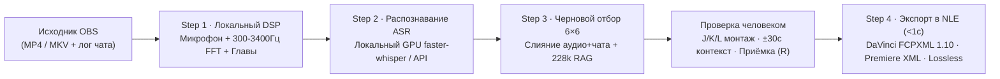

<div align="center">

[English](../../README.md) · [简体中文](./README.zh-CN.md) · [繁體中文](./README.zh-TW.md) · [日本語](./README.ja.md) · [한국어](./README.ko.md) · **Русский** · [Español](./README.es.md)

<h1>Solacut: Локальный ассистент монтажа VOD и студия субтитров на 6 языках</h1>

<h3>Полностью локальная NLE-среда для чернового разбора многочасовых стримов, живой локализации субтитров на 6 языков и мгновенной передачи таймлайна в профессиональные монтажки.</h3>

<p>Загрузите 4-часовую запись стрима. Находите реальные хайлайты, исправляйте буквальный перевод игрового сленга и экспортируйте готовый таймлайн в Premiere Pro и DaVinci Resolve менее чем за 1 секунду — 100% на вашем ПК, без загрузки в облако.</p>

[](https://github.com/Entelina/solacut/releases)
[](../../LICENSE)
[-3b82f6)](https://solacut.com)
[](#локализация-на-6-языков-и-локальный-корпус)
[](../../THIRD_PARTY_NOTICES.md)
[](../../SECURITY.md)

[**Официальный сайт**](https://solacut.com) · [**Скачать Portable (.zip)**](https://github.com/Entelina/solacut/releases/latest) · [**Руководство**](../../USER_MANUAL.md) · [**Безопасность**](../../SECURITY.md)

[Быстрый старт](#быстрый-старт) · [Философия](#почему-solacut-ассистент-монтажёра-а-не-генератор-ии-шлака) · [Как это работает](#как-это-работает) · [Студия 6 языков](#локализация-на-6-языков-и-локальный-корпус) · [CLI-конвейер](#модульный-cli-конвейер) · [FAQ](#частые-вопросы-faq)

`Solacut.exe  # Без API-ключа: откройте Help → Load 30s Demo Project для мгновенного теста`

<br/>


</div>

---

## Почему Solacut: ассистент монтажёра, а не генератор «ИИ-шлака»

Авторы и клипмейкеры устали от облачных «ИИ-нарезчиков», которые заставляют выгружать десятки гигабайт исходников, берут поминутную оплату, режут фразы на полуслове и уродуют игровой юмор машинным калькированием.

**Solacut создан по принципу Human-in-the-Loop — как надёжный локальный ассистент монтажёра, оставляющий финальное решение за человеком**:

- **100% локально · ноль выгрузки видео**: Исходники MP4 / MKV / MOV никогда не покидают ваш диск. Аудио-DSP, чтение глав OBS, индексация чата и поиск по корпусу выполняются офлайн за миллисекунды.
- **Тройной радар хайлайтов (Голос + Главы OBS + Активность чата)**:
  - Автоматически анализирует многодорожечные записи OBS, рекомендует изолированную дорожку микрофона и применяет полосовой FFT-фильтр `300–3400 Гц` (NumPy), отсекая ложные срабатывания от взрывов и рёва моторов.
  - Находит паузы тишины / AFK `>= 15 с` для быстрого пропуска (`Skip Air`) при отсмотре без разрушения естественных речевых пауз.
  - Нативно извлекает встроенные **маркеры глав OBS** и импортирует логи чата **TwitchDownloader JSON / Bilibili XML / YouTube Live Chat** в локальную базу SQLite FTS5 (`имба`, `жесть`, `ахах`, `OMEGALUL`, `CLIP IT`), безошибочно ловя бесшумные клатчи и тонкую иронию.
- **Монтаж по полному транскрипту и контекст `±30s Source Context`**:
  - Даже без LLM можно искать реплики по всему стриму во вкладке `Transcript` и собирать клипы вручную.
  - Кнопка **`±30s Source Context`** показывает ±30 секунд окружающего диалога, защищая от потери контекста при переводе.
- **Шлюз приёмки `Draft → Reviewed` и передача в NLE `< 1 с`**:
  - Черновики ИИ помечаются как `Draft`; после проверки клавиша `R` переводит клип в статус `✓ Reviewed` (режим `Only Reviewed` включён по умолчанию).
  - Экспорт за `< 1 с` без перекодирования в **DaVinci Resolve / Final Cut Pro `FCPXML 1.10`** (две секвенции) и **Premiere Pro `FCP7 XML (xmeml v5)`**, а также lossless-нарезка FFmpeg с компенсацией ключевых кадров.

---

## Быстрый старт

### Вариант 1: Портативная версия для Windows 64-bit (Рекомендуется)

1. Скачайте свежий архив `Solacut-v*-win64-portable.zip` с [**solacut.com**](https://solacut.com) или [**GitHub Releases**](https://github.com/Entelina/solacut/releases/latest).
2. Распакуйте в любую папку и запустите **`Solacut.exe`** (статические `ffmpeg`/`ffprobe`, оболочка Edge WebView2 и коммерчески чистый корпус на 228 210 пар уже внутри — Python не требуется).
3. **Попробуйте без API-ключа**: нажмите **`Load 30s Demo Project`** в стартовом окне (или `Help → Load 30s Demo Project`), чтобы протестировать реальный геймплей с двумя аудиодорожками, главами OBS и пиками чата полностью офлайн.

### Вариант 2: Запуск из исходников (Windows PowerShell · Python 3.11)

```powershell
# Нативное безрамочное десктоп-приложение (рекомендуется)
.\.venv\Scripts\pythonw.exe src/desktop_app.py

# Режим отладки в браузере
.\.venv\Scripts\python.exe src/desktop_app.py --browser
```

---

## Как это работает



---

## Локализация на 6 языков и локальный корпус

- **Поддерживаемые языки (интерфейс и субтитры 6×6)**: `English (en)` · `简体中文 (zh)` · `日本語 (ja)` · `한국어 (ko)` · `Русский (ru)` · `Español (es)`
- **5 режимов предпросмотра субтитров (CC)**: Двуязычные (перевод сверху / оригинал сверху) · Только перевод · Только оригинал · Выкл.
- **Двухуровневый лицензионно чистый корпус**: В портативную сборку включены **228 210 пар** со свободными коммерческими лицензиями (`MIT / CC BY 2.0 / CC BY-SA 4.0` + словарь игрового сленга Solacut). Для личных исследований индекс можно расширить локально до **600 000 пар** во вкладке `Glossary` (см. [`THIRD_PARTY_NOTICES.md`](../../THIRD_PARTY_NOTICES.md)).

---

## Модульный CLI-конвейер

```powershell
.\.venv\Scripts\python.exe src/step1_audio.py input/obs_vod.mkv --audio-stream 1
.\.venv\Scripts\python.exe src/step2_asr.py output/obs_vod_audio_peaks.json --asr-provider local --asr-model large-v3-turbo
.\.venv\Scripts\python.exe src/step3_llm.py output/obs_vod_transcript.json
.\.venv\Scripts\python.exe src/step4_cut.py output/obs_vod_highlights.json --mode nle_only --only-reviewed
```

---

## Частые вопросы (FAQ)

<details>
<summary><b>Отправляет ли Solacut мои видео или ключи API на сторонние серверы?</b></summary>
<br/>
Никогда. В Solacut нет телеметрии, облачных аккаунтов и серверов загрузки медиа. Все видеофайлы остаются на вашем локальном диске. Подробности в <a href="../../SECURITY.md"><code>SECURITY.md</code></a>.
</details>

---

## Лицензия

Распространяется под лицензией [MIT License](../../LICENSE). Уведомления об открытых компонентах, FFmpeg и корпусах приведены в [`THIRD_PARTY_NOTICES.md`](../../THIRD_PARTY_NOTICES.md).
