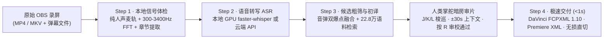

<div align="center">

[English](../../README.md) · **简体中文** · [繁體中文](./README.zh-TW.md) · [日本語](./README.ja.md) · [한국어](./README.ko.md) · [Русский](./README.ru.md) · [Español](./README.es.md)

<h1>Solacut：开源纯本地长录屏助理剪辑与六语种审校工作台</h1>

<h3>专为数小时游戏录屏粗筛、六语种母语级字幕精修与专业 NLE 时间线交付打造的纯本地暗房工作台。</h3>

<p>拖入 4 小时原始录屏，在本地精准锁定真高能瞬间、纠偏游戏黑话机翻，1 秒内将干净时间线直通 Premiere Pro 与 DaVinci Resolve —— 100% 本机运行，零云端上传。</p>

[](https://github.com/Entelina/solacut/releases)
[](../../LICENSE)
[-3b82f6)](https://solacut.com)
[](#六语种本地化与双层合规语料库)
[](../../THIRD_PARTY_NOTICES.md)
[](../../SECURITY.md)

[**官方网站**](https://solacut.com) · [**下载 Win64 免装便携包 (.zip)**](https://github.com/Entelina/solacut/releases/latest) · [**完整操作手册**](../../USER_MANUAL.md) · [**隐私与安全规范**](../../SECURITY.md)

[快速开始](#快速开始) · [设计理念](#为什么选择-solacut做助理剪辑拒绝-ai-电子垃圾) · [工作原理](#工作原理) · [六语种工作台](#六语种本地化与双层合规语料库) · [命令行流水线](#模块化命令行流水线) · [常见问题](#常见问题-faq)

`Solacut.exe  # 无需 API Key：打开软件点击 Help → Load 30s Demo Project 即可体验真机示例`

<br/>


</div>

---

## 为什么选择 Solacut：做助理剪辑，拒绝 AI 电子垃圾

创作者苦“黑盒 AI 切片网站”久矣——动辄上传几十 GB 源素材、按分钟高价扣费、乱切气口破坏节目效果、把外语反讽与游戏黑话生硬直译，最后套上廉价营销号模板批量制造无人观看的“AI 电子垃圾（AI Slop）”。

**Solacut 的定位是听你指挥的「本地助理剪辑师（Assistant Editor）」，绝不越俎代庖取代人类审美**：

- **100% 本地闭环，零视频上传**：MP4/MKV/MOV 原片全程留在本地硬盘。多音轨信号分析、OBS 章节读取、弹幕热力图建库与本地语料检索均在毫秒级离线完成。
- **人声 + OBS 章节 + 弹幕三轨高光雷达**：
  - 自动探测 OBS 多音轨封装并推荐纯净主播麦克风轨，通过纯 NumPy `300–3400 Hz` 人声带通 FFT 过滤枪炮爆炸与引擎轰鸣误报；
  - 自动标记 `>= 15s` 的挂机死寂空白段（审片可开 `Skip Air` 自动跳空，绝不切碎正常说话气口）；
  - 原生提取视频内嵌 **OBS Chapter Markers（章节标记）**，并支持导入 **TwitchDownloader JSON / B站 XML / YouTube Live Chat** 弹幕，利用本地 SQLite FTS5 绘制刷屏热度曲线与跨语种梗词爆点（`OMEGALUL` / `CLIP IT` / `草` / `666` / `ㅋㅋ` / `www`），轻松捕捉无声神操作与冷面反讽。
- **全片逐字稿搜词建片 & `±30s Source Context` 上下文核查**：
  - 哪怕完全不开大模型，也可在 `Transcript` 面板搜索任意台词、勾选连续句子一键生成片段；
  - 审校任意片段时可一键展开 **`±30s Source Context`（前后 30 秒原片上下文）**，彻底杜绝断章取义与反讽翻车。
- **`Draft → Reviewed` 人工审校品控门禁**：
  - AI 初筛候选默认标为琥珀色 `Draft` 并自动提示高黑话密度或回退句子；人工核验后按 `R` 键标为绿色 `✓ Reviewed`。交付面板默认勾选 **`Only Reviewed`（仅导出已审片段）**。
- **专业 NLE 优先交付（`< 1s` 零转码直通主力剪辑软件）**：
  - 默认 **`NLE XML`** 模式在 1 秒内生成严格符合规范的 **DaVinci Resolve / Final Cut Pro `FCPXML 1.10` 双序列时间线** 与 **Premiere Pro `FCP7 XML (xmeml v5)`**（完整保留双声道立体声、`masterclipid` 与 OBS 章节标记），同时附带 CMX 3600 EDL、DaVinci CSV、对齐 `.srt`，或长 GOP 关键帧偏移补偿的 FFmpeg 原画无损切片。

---

## 快速开始

### 方式一：Windows 64-bit 免 Python 便携包（强烈推荐）

1. 前往 [**solacut.com**](https://solacut.com) 或 [**GitHub Releases**](https://github.com/Entelina/solacut/releases/latest) 下载最新 `Solacut-v*-win64-portable.zip`。
2. 解压至任意目录，双击 **`Solacut.exe`** 即可启动（已内置静态 `ffmpeg`/`ffprobe`、Edge WebView2 原生无边框暗房界面与 228,210 条商用无限制双语语料索引，无需安装 Python）。
3. **零配置先试手感**：在欢迎弹窗或顶部菜单 **`Help → Load 30s Demo Project`** 一键载入内置 30 秒开源游戏实机工程（含真实竞速画面、双音轨解说、3 个 OBS 章节与 50 条多语种弹幕峰值），离线体验全套审校与导出流程。

### 方式二：源码运行（Windows PowerShell · Python 3.11）

> 工程固定使用 **Python 3.11** 独立环境，确保 `faster-whisper` / `ctranslate2` 与 CUDA 轮子开箱稳定。

```powershell
# 启动原生无边框桌面工作台（推荐）
.\.venv\Scripts\pythonw.exe src/desktop_app.py

# 或以浏览器调试模式启动
.\.venv\Scripts\python.exe src/desktop_app.py --browser
```

---

## 工作原理



---

## 六语种本地化与双层合规语料库

工作台界面（默认 `English`，右上角一键热切）与 `6×6` 字幕引擎完整覆盖六大语种：

- **支持语种**：`English (en)` · `简体中文 (zh)` · `日本語 (ja)` · `한국어 (ko)` · `Русский (ru)` · `Español (es)`
- **5 种监视器实时 CC 叠字模式**：译上原下 · 原上译下 · 仅译文 · 仅原文 · 关闭字幕，支持一键切换目标语种重译及零缺字 ASS 字体自动匹配。
- **版权透明的本地平行语料分级**：
  - **便携包默认内置商用合规库（`228,210` 条）**：严格通过 `--commercial-only` 构建（仅含 `MIT / CC BY 2.0 / CC BY-SA 4.0` 及 Solacut 原创游戏黑话反直译词库），可用于商业视频制作。
  - **可选本地个人研究扩展库（`600,000` 条）**：可在「词库 / Glossary」面板一键按需从 OPUS 官方公开镜像拉取口语库至个人电脑本地索引（详见 [`THIRD_PARTY_NOTICES.md`](../../THIRD_PARTY_NOTICES.md)）。

---

## 模块化命令行流水线

```powershell
# Step 1：探测 OBS 音轨并在第 1 号纯人声麦轨执行带通峰值与死寂段分析
.\.venv\Scripts\python.exe src/step1_audio.py input/obs_vod.mkv --list-streams
.\.venv\Scripts\python.exe src/step1_audio.py input/obs_vod.mkv --audio-stream 1

# Step 2：使用本地 RTX 显卡离线 faster-whisper 转写（或省略参数走已配置的云端 ASR）
.\.venv\Scripts\python.exe src/step2_asr.py output/obs_vod_audio_peaks.json --asr-provider local --asr-model large-v3-turbo

# Step 3：高光初筛与 6×6 双语初译
.\.venv\Scripts\python.exe src/step3_llm.py output/obs_vod_transcript.json

# Step 4A：<1s 零转码导出 DaVinci FCPXML 1.10 + Premiere XML（仅放行已人工审校片段）
.\.venv\Scripts\python.exe src/step4_cut.py output/obs_vod_highlights.json --mode nle_only --only-reviewed

# Step 4B：关键帧偏移补偿原画无损直切
.\.venv\Scripts\python.exe src/step4_cut.py output/obs_vod_highlights.json --mode lossless --only-reviewed
```

---

## 常见问题 (FAQ)

<details>
<summary><b>Solacut 会上传我的视频素材或收集遥测数据吗？</b></summary>
<br/>
绝不。Solacut 零遥测、零账号体系、零云端中转服务器。你的所有视频始终保存在本地磁盘；若配置可选的 BYOK 云端模型（或本地 Ollama/vLLM），请求仅在你本机与目标接口间直连，且密钥在日志中强制脱敏。详见 <a href="../../SECURITY.md"><code>SECURITY.md</code></a>。
</details>

<details>
<summary><b>完全不配 API Key 可以免费使用哪些功能？</b></summary>
<br/>
多音轨波形检查、<code>&gt;=15s</code> 死寂空白跳过、OBS 章节一键转片段、Twitch/B站/YouTube 弹幕热度峰值检索、本地显卡 <code>faster-whisper</code> 语音转写、全片逐字稿搜词剪辑、以及 DaVinci / Premiere XML 时间线与无损切片导出，均可 100% 离线免费运行。
</details>

---

## 开源许可与致谢

本项目基于 [MIT License](../../LICENSE) 开源。内置开源组件、FFmpeg 独立二进制许可及开放平行语料与示例素材署名详见 [`THIRD_PARTY_NOTICES.md`](../../THIRD_PARTY_NOTICES.md)。
