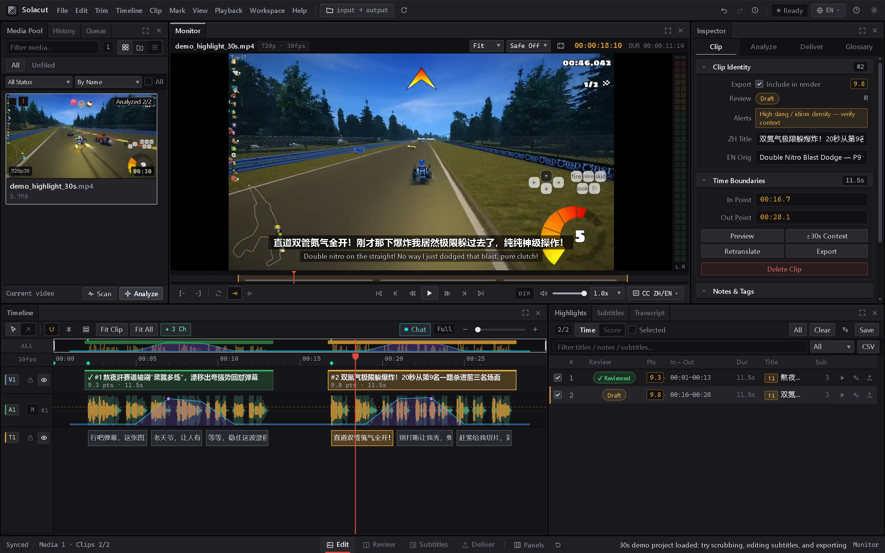
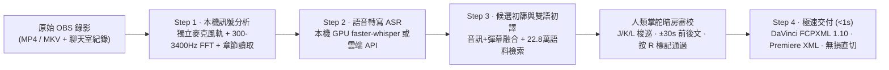

<div align="center">

[English](../../README.md) · [简体中文](./README.zh-CN.md) · **繁體中文** · [日本語](./README.ja.md) · [한국어](./README.ko.md) · [Русский](./README.ru.md) · [Español](./README.es.md)

<h1>Solacut：開源純本機長錄影助理剪輯與六語種審校工作台</h1>

<h3>專為數小時遊戲錄影粗剪、六語種母語級字幕精修與專業 NLE 時間軸交付打造的純本機暗房工作台。</h3>

<p>拖入 4 小時原始 VOD 錄影，在本機精準鎖定真實高能瞬間、修正遊戲俚語機翻，1 秒內將乾淨時間軸直通 Premiere Pro 與 DaVinci Resolve —— 100% 本機執行，零雲端上傳。</p>

[](https://github.com/Entelina/solacut/releases)
[](../../LICENSE)
[-3b82f6)](https://solacut.com)
[](#六語種在地化與雙層合規語料庫)
[](../../THIRD_PARTY_NOTICES.md)
[](../../SECURITY.md)

[**官方網站**](https://solacut.com) · [**下載 Win64 免安裝便攜版 (.zip)**](https://github.com/Entelina/solacut/releases/latest) · [**完整操作手冊**](../../USER_MANUAL.md) · [**隱私與資安規範**](../../SECURITY.md)

[快速開始](#快速開始) · [設計理念](#為什麼選擇-solacut做助理剪輯拒絕-ai-垃圾切片) · [運作架構](#運作架構) · [六語種工作台](#六語種在地化與雙層合規語料庫) · [指令列管線](#模組化指令列管線) · [常見問題](#常見問題-faq)

`Solacut.exe  # 無需 API Key：開啟軟體點擊 Help → Load 30s Demo Project 即可離線體驗真機範例`

<br/>



</div>

---

## 為什麼選擇 Solacut：做助理剪輯，拒絕 AI 垃圾切片

創作者早已厭倦「黑盒 AI 自動切片網站」——動輒上傳數十 GB 原始素材、按分鐘計費、亂切節奏破壞笑點、把外語反諷與實況迷因生硬直譯，最後套上廉價模板產出沒人想看的「AI 垃圾片（AI Slop）」。

**Solacut 的核心哲學是 Human-in-the-Loop（人類掌舵）——只當你最省力的「本機助理剪輯師」，絕不取代創作者的最終審美**：

- **100% 本機閉環，零影片上傳**：MP4/MKV/MOV 原始檔案全程留在你的硬碟。多音軌頻譜分析、OBS 章節讀取、聊天室熱度索引與語料檢索皆於毫秒級離線完成。
- **人聲 + OBS 章節 + 聊天室三軌精華雷達**：
  - 自動偵測 OBS 多音軌並推薦乾淨實況主麥克風軌，透過純 NumPy `300–3400 Hz` 人聲帶通 FFT 濾除槍砲爆炸與引擎雜音誤報；
  - 標記 `>= 15s` 的掛網空白段（審片可開啟 `Skip Air` 自動跳過死寂，絕不破壞自然語氣停頓）；
  - 原生讀取影片內嵌 **OBS Chapter Markers（章節標記）**，並支援匯入 **TwitchDownloader JSON / Bilibili XML / YouTube Live Chat** 彈幕紀錄，建立本機 SQLite FTS5 熱度曲線與跨語種迷因峰值（`OMEGALUL` / `CLIP IT` / `草` / `666` / `ㅋㅋ` / `www`），精準捕捉無聲神操作與冷面吐槽。
- **全片逐字稿搜詞剪輯 & `±30s Source Context` 前後文核對**：
  - 即使完全不使用 AI 選片，也能在 `Transcript` 面板搜尋關鍵字、勾選台詞一鍵建立片段；
  - 審校任一片段時可一鍵展開 **`±30s Source Context`（前後 30 秒原片上下文）**，徹底防止斷章取義與反諷誤譯。
- **`Draft → Reviewed` 人工品管閘門**：
  - AI 初篩草稿預設標示為琥珀色 `Draft` 並提示高俚語密度；人工確認後按 `R` 鍵標為綠色 `✓ Reviewed`，交付頁預設勾選 **`Only Reviewed`**。
- **專業 NLE 優先交付（`< 1s` 零轉碼直通主力剪輯軟體）**：
  - 預設 **`NLE XML`** 模式於 1 秒內輸出符合規範的 **DaVinci Resolve / Final Cut Pro `FCPXML 1.10` 雙序列時間軸** 與 **Premiere Pro `FCP7 XML (xmeml v5)`**（完整保留雙聲道立體聲、`masterclipid` 與 OBS 章節標記），亦支援無損直切與 9:16 / 16:9 雙語字幕壓製。

---

## 快速開始

### 方式一：Windows 64-bit 免 Python 便攜版（推薦）

1. 前往 [**solacut.com**](https://solacut.com) 或 [**GitHub Releases**](https://github.com/Entelina/solacut/releases/latest) 下載最新 `Solacut-v*-win64-portable.zip`。
2. 解壓縮至任意資料夾，雙擊 **`Solacut.exe`** 即可啟動（內建靜態 `ffmpeg`/`ffprobe`、Edge WebView2 無邊框暗房介面與 228,210 條商用無限制雙語語料索引）。
3. **免金鑰立即試玩**：點擊歡迎視窗或頂部選單 **`Help → Load 30s Demo Project`**，即可載入內建 30 秒開源實機競速專案（含雙音軌實況解說、OBS 章節與聊天室爆點），零設定體驗完整流程。

### 方式二：原始碼執行（Windows PowerShell · Python 3.11）

```powershell
# 啟動原生無邊框桌面工作台（推薦）
.\.venv\Scripts\pythonw.exe src/desktop_app.py

# 或以瀏覽器除錯模式啟動
.\.venv\Scripts\python.exe src/desktop_app.py --browser
```

---

## 運作架構



---

## 六語種在地化與雙層合規語料庫

- **支援語種**：`English (en)` · `简体中文 (zh)` · `日本語 (ja)` · `한국어 (ko)` · `Русский (ru)` · `Español (es)`
- **5 種監視器即時 CC 疊字預覽**：譯上原下 · 原上譯下 · 僅譯文 · 僅原文 · 關閉字幕。
- **雙層授權透明語料庫**：便攜版預設僅內建 **228,210 條**可商用開放語料（`MIT / CC BY 2.0 / CC BY-SA 4.0`）；個人學習與研究可於 `Glossary` 面板一鍵擴充至 **600,000 條**口語索引（詳見 [`THIRD_PARTY_NOTICES.md`](../../THIRD_PARTY_NOTICES.md)）。

---

## 模組化指令列管線

```powershell
.\.venv\Scripts\python.exe src/step1_audio.py input/obs_vod.mkv --audio-stream 1
.\.venv\Scripts\python.exe src/step2_asr.py output/obs_vod_audio_peaks.json --asr-provider local --asr-model large-v3-turbo
.\.venv\Scripts\python.exe src/step3_llm.py output/obs_vod_transcript.json
.\.venv\Scripts\python.exe src/step4_cut.py output/obs_vod_highlights.json --mode nle_only --only-reviewed
```

---

## 常見問題 (FAQ)

<details>
<summary><b>Solacut 會上傳我的影片檔案或收集遙測資料嗎？</b></summary>
<br/>
絕不。Solacut 零遙測、零帳號系統、零雲端中轉伺服器，所有媒體檔案始終留在你的本機磁碟。詳見 <a href="../../SECURITY.md"><code>SECURITY.md</code></a>。
</details>

---

## 開源授權

本專案採用 [MIT License](../../LICENSE) 釋出，第三方開源元件與語料署名請參閱 [`THIRD_PARTY_NOTICES.md`](../../THIRD_PARTY_NOTICES.md)。
